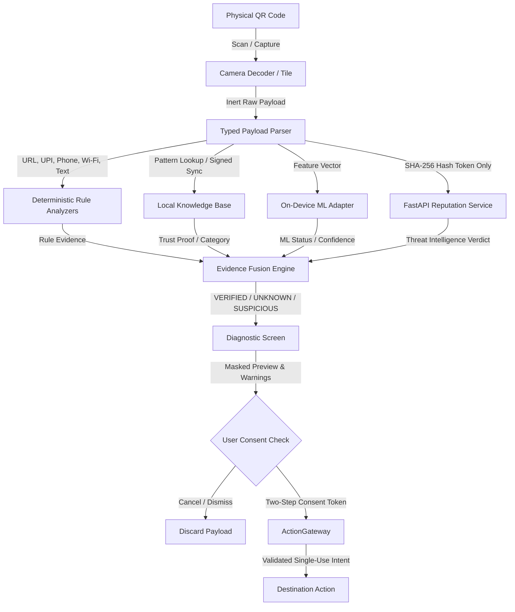

# Peek-in QR

**A Local-First, Network-Augmented QR Risk Assessment and Pre-Navigation Security Application**

Peek-in QR is a mobile security application designed to protect mobile users against QR-code-based exploitation by enforcing an immutable **"Peek → Assess → Decide → Act"** security checkpoint. Rather than immediately delegating decoded payloads to system handlers or browser activities, Peek-in QR treats all physical QR inputs as untrusted data, evaluates them locally with deterministic analyzers and cryptographic knowledge bases, and requires explicit user consent through an ActionGateway before any external intent is dispatched.

---

## Table of Contents

- [Project Overview](#project-overview)
- [Key Features](#key-features)
- [How Peek-in QR Works](#how-peek-in-qr-works)
- [Technology Stack](#technology-stack)
- [Repository Structure](#repository-structure)
- [Getting Started](#getting-started)
- [Security and Privacy](#security-and-privacy)
- [Project Status and Roadmap](#project-status-and-roadmap)
- [Testing and Quality Assurance](#testing-and-quality-assurance)
- [Contributing](#contributing)
- [License](#license)
- [Acknowledgments / Academic Context](#acknowledgments--academic-context)

---

## Project Overview

### The QR Code Security Problem

Quick Response (QR) codes are ubiquitous optical labels used for website navigation, contactless peer-to-merchant payments, Wi-Fi onboarding, and mobile dialing. However, standard camera scanners and system intent routers automatically parse and open QR contents with minimal visual diagnostics, exposing users to severe risks:

- **QR Phishing (Quishing):** Obfuscated URLs utilizing raw IP hosts, decimal/hexadecimal encodings, Internationalized Domain Name (IDN) homoglyph confusables, and excessive subdomains to impersonate legitimate services.
- **Payment Diversion (UPI Fraud):** Altered Virtual Payment Addresses (VPAs) or manipulated transaction parameters (`am`, `cu`, `pa`, `pn`) redirecting consumer funds to unauthorized beneficiaries.
- **Rogue Wireless Connections:** Unsolicited Wi-Fi credentials auto-joining rogue access points or unencrypted networks that facilitate traffic interception.
- **Toll Escalation & Injection:** `tel:` URI abuse launching premium-rate calls, control character injection, or prompt injection strings designed to mislead automated systems.

### The Peek-in QR Solution

Peek-in QR acts as an isolated pre-navigation gatekeeper. All QR payloads remain completely **inert** upon decode. The application performs multi-layered deterministic security analysis and local Knowledge Base lookups entirely on-device, presenting the user with an explainable diagnostic verdict (`VERIFIED`, `UNKNOWN`, or `SUSPICIOUS`) and gated action controls before any external navigation or execution can occur.

---

## Key Features

The project incorporates multiple analysis modules and defensive controls. Features are strictly classified by their verified development state:

| Feature | Category | Status | Details |
|---|---|---|---|
| **Typed Safe Parsers** | Core Payload | **Implemented & Verified** | Bounded, side-effect-free parsers for URL, UPI (`upi://pay`), Phone (`tel:`), Wi-Fi (`WIFI:...`), and Text formats (`apps/mobile/lib/core/payload/`). |
| **Deterministic Security Analyzers** | Core Rules | **Implemented & Verified** | Analyzers for raw IP hosts, IDN/Punycode confusables, embedded userinfo, duplicate parameters, invalid UPI formats, open Wi-Fi networks, and prompt injections (`apps/mobile/lib/core/rules/`). |
| **Immutable Rule Evidence** | Explainability | **Implemented & Verified** | Structured diagnostic findings with outcome states (`matched`, `notMatched`, `inconclusive`, `error`) and severity levels. |
| **Local Knowledge Base** | Trust Authority | **Implemented & Verified** | SQLite-compatible repository supporting SHA-256 pattern lookup, trust assertions, provenance tracking, and expiration enforcement (`apps/mobile/lib/core/kb/`). |
| **Tri-State Evidence Fusion** | Policy Engine | **Implemented & Verified** | Positive-proof policy: `VERIFIED` requires authenticated KB proof + clean rules; malicious findings yield `SUSPICIOUS`; lack of proof defaults to `UNKNOWN`. |
| **Pre-Navigation ActionGateway** | Security Gate | **Implemented & Verified** | Sole pathway for external intent dispatch; blocks `SUSPICIOUS` verdicts, enforces two-step consent for `UNKNOWN`, and invalidates single-use `ConsentToken` instances. |
| **Diagnostic UI & Inert Scanner** | User Interface | **Implemented & Verified** | Viewfinder and manual entry UI with launch badges, explainable reasons list, degraded component chips, and redacted target previews. |
| **Android Quick Settings Tile** | Native Platform | **Implemented & Verified** | Native Kotlin `PeekQuickSettingsTileService` allowing single-tap scanner launch without auto-execution. |
| **Scan History with Redaction** | Privacy & Audit | **Implemented & Verified** | Local history recording masked summaries, scan IDs, and consent states; raw payloads excluded by default with complete local deletion. |
| **On-Device ML Feature Extractor** | Machine Learning | **Implemented & Verified** | Deterministic numerical extraction (entropy, digit ratio, symbol ratio, host depth, flags) in `apps/mobile/lib/core/ml/feature_extractor.dart`. |
| **On-Device ML Inference Adapter** | Machine Learning | **Adapter Implemented** | Adapter safely reports `unavailable` until a licensed, provenance-validated model artifact is acquired, preserving safe deterministic fallback. |
| **Network Reputation Service** | Backend | **Implemented & Verified** | FastAPI microservice in `services/reputation/` with strict Pydantic schemas rejecting raw URLs/PII, Redis TTL caching, and in-memory fallback. |
| **Safe Reputation Client** | Client Network | **Implemented & Verified** | Dart `SafeReputationClient` transmitting only SHA-256 hash tokens, with timeouts falling back safely to `UNAVAILABLE` without blocking offline analysis. |
| **Signed Knowledge Base Updates** | Supply Chain | **Implemented & Verified** | `SignedKnowledgeBaseDelta` with HMAC-SHA256 signature verification over pinned keys, monotonic version anti-rollback (`deltaVersion > currentVersion`), and atomic rollback (`apps/mobile/lib/core/kb/kb_sync.dart`). |
| **Diagnostic Report Generator** | Audit & Export | **Implemented & Verified** | Machine-readable and redacted diagnostic export generator (`apps/mobile/lib/core/kb/report_generator.dart`) with mandatory redaction of secrets. |
| **Performance Benchmark Suite** | Performance | **Implemented & Verified** | Automated latency benchmark suite (`apps/mobile/test/performance_benchmark_test.dart`) verifying local decision path latency is well under the <100ms threshold. |
| **Android APK Build** | Distribution | **Built & Verified** | Successfully assembled installable debug APK (`apps/mobile/build/app/outputs/flutter-apk/app-debug.apk`) against Android SDK (minSdk 26). |

---

## How Peek-in QR Works

Peek-in QR follows a strict, sequential pipeline where untrusted input passes through multiple isolated evaluation stages before any external action can be triggered:



### Invariant Pipeline Stages

1. **Inert Decode:** Captured payload strings are stored ephemerally without executing implicit system intents or resolving network URIs.
2. **Typed Safe Parsing:** Inputs are bounded (max 8,192 characters) and parsed into structured models (`UrlPayload`, `UpiPayload`, `PhonePayload`, `WifiPayload`, `TextPayload`).
3. **Deterministic Rule Analysis:** Emits typed `RuleEvidence` covering lexical, syntactic, and structural anomalies.
4. **Knowledge Base Verification & Sync:** Performs SHA-256 pattern lookups against local authenticated entities, with support for cryptographically signed, anti-rollback delta updates.
5. **On-Device Feature Extraction:** Computes statistical and lexical feature vectors locally with zero network reliance.
6. **Optional Privacy-Preserving Reputation:** Dispatches anonymous SHA-256 hash tokens to the FastAPI backend without transmitting raw URLs, queries, or PII.
7. **Evidence Fusion:** Evaluates rule findings and KB trust proofs to produce an authoritative tri-state verdict (`VERIFIED`, `UNKNOWN`, or `SUSPICIOUS`).
8. **ActionGateway Consent:** Validates single-use `ConsentToken` instances to prevent Time-Of-Check to Time-Of-Use (TOCTOU) exploits, blocking suspicious targets and requiring confirmation for unknown targets.

---

## Technology Stack

### Mobile Client (`apps/mobile/`)
- **Framework:** Flutter 3.41.2 (Dart SDK 3.11.0)
- **Target Platform:** Android 8.0+ (minimum SDK 26, target SDK 34+)
- **Native Android Integration:** Kotlin 1.9.22, `TileService` (`PeekQuickSettingsTileService.kt`), Android Platform Channels (`MainActivity.kt`)
- **Security & Crypto:** Pure Dart cryptographic SHA-256 and HMAC-SHA256 hashing (`crypto: ^3.0.6`)
- **Local Storage:** Versioned SQLite-compatible knowledge base and scan history repository with atomic transactions
- **On-Device ML Architecture:** Pure-Dart `FeatureExtractor` and `MlModelAdapter` abstraction

### Backend Threat Reputation Microservice (`services/reputation/`)
- **Language & Framework:** Python 3.12, FastAPI, Pydantic 2.14
- **Web Server:** Uvicorn (ASGI)
- **Caching & Fallback:** Redis 8.1 client with TTL expiration and in-memory mock cache
- **Containerization:** Docker (`services/reputation/Dockerfile`)

### Security Enforcement & Tooling (`scripts/`, `.github/`)
- **CI / Static Analysis:** GitHub Actions workflow running on Ubuntu, `flutter analyze --fatal-infos`
- **Security Check Script:** Python 3.12 script (`scripts/security_check.py`) enforcing secret scanning, repository documentation policies, and security invariants

---

## Repository Structure

The project follows a monorepo architecture:

```text
.
├── .github/
│   └── workflows/
│       └── ci.yml                 # Continuous Integration workflow
├── .gitignore                     # Repository ignore rules (secrets, build caches)
├── README.md                      # Official project documentation (sole permitted markdown file)
├── scripts/
│   └── security_check.py          # Security verification & policy enforcement runner
├── services/
│   └── reputation/                # FastAPI threat reputation microservice
│       ├── Dockerfile             # Container definition for reputation backend
│       ├── requirements.txt       # Python dependencies (FastAPI, Redis, Pydantic, Pytest)
│       ├── app/
│       │   ├── main.py            # API routes, caching, and rate-limiting
│       │   └── schemas.py         # Strict PII/URL-blocking Pydantic validation schemas
│       └── tests/
│           └── test_reputation_api.py # Automated backend test suite
└── apps/
    └── mobile/                    # Flutter Android mobile client
        ├── android/               # Native Android configuration and Kotlin tile service
        │   └── app/src/main/
        │       ├── AndroidManifest.xml
        │       └── kotlin/org/peekinqr/peek_in_qr/
        │           ├── MainActivity.kt
        │           └── PeekQuickSettingsTileService.kt
        ├── lib/
        │   ├── main.dart          # Application entrypoint & channel binding
        │   ├── core/
        │   │   ├── execution/     # ActionGateway & ConsentToken model
        │   │   ├── fusion/        # Tri-state FusionEngine & EvaluationResult
        │   │   ├── kb/            # KnowledgeBaseEntry, sync verifier & report generator
        │   │   ├── ml/            # FeatureExtractor & MlModelAdapter
        │   │   ├── payload/       # ParsedPayload & PayloadParser
        │   │   ├── reputation/    # SafeReputationClient & network adapter
        │   │   └── rules/         # RuleEngine & deterministic analyzers
        │   └── features/
        │       ├── diagnostics/   # DiagnosticScreen & gated controls
        │       └── scanner/       # ScannerScreen & viewfinder UI
        ├── test/                  # Test suites (unit, widget, and adversarial fixtures)
        │   ├── action_gateway_test.dart
        │   ├── fixtures/adversarial_fixtures.dart
        │   ├── fusion_engine_test.dart
        │   ├── kb_sync_test.dart
        │   ├── ml_test.dart
        │   ├── parsers_and_rules_test.dart
        │   ├── performance_benchmark_test.dart
        │   ├── reputation_client_test.dart
        │   └── scanner_screen_test.dart
        └── pubspec.yaml           # Flutter package manifest
```

---

## Getting Started

### Prerequisites

Ensure the following development toolchains are installed:
- **Flutter SDK:** Version 3.41.x or later with Dart 3.11.x
- **Android SDK:** Platforms `android-34` or higher, build-tools `34.0.0` or higher, minimum API 26
- **Java Development Kit:** OpenJDK 17 or OpenJDK 21
- **Python:** Python 3.12 or later (for running repository security checks and backend service)
- **Docker:** (Optional) for running containerized backend service

Verify your local environment:
```bash
flutter doctor -v
python3 --version
```

### Setup Instructions

1. **Clone the Repository:**
   ```bash
   git clone https://github.com/your-org/peek-in-qr.git
   cd peek-in-qr
   ```

2. **Run Security & Guardrail Verification:**
   ```bash
   python3 scripts/security_check.py
   ```

3. **Install Mobile Dependencies & Run Tests:**
   ```bash
   cd apps/mobile
   flutter pub get
   flutter analyze --fatal-infos
   flutter test
   ```

4. **Build Android APK:**
   ```bash
   flutter build apk --debug
   # Produced APK located at build/app/outputs/flutter-apk/app-debug.apk
   ```

5. **Run Mobile Client:**
   Launch an Android emulator (API 26+) or connect an Android physical device with USB debugging:
   ```bash
   flutter run -d android
   ```

6. **Run Reputation Backend (Optional):**
   ```bash
   cd services/reputation
   pip install -r requirements.txt
   PYTHONPATH=../.. pytest -o cache_dir=/tmp/.pytest_cache tests/
   uvicorn app.main:app --host 0.0.0.0 --port 8000
   ```

---

## Security and Privacy

### Non-Negotiable Invariants

1. **Pipeline Invariant:** `scan -> parse -> rules/KB/ML/(optional net) -> fusion -> diagnostics -> consent -> ActionGateway`. There is no direct execution pathway from decoder to destination action.
2. **Untrusted Inputs:** All QR payloads are treated as untrusted data. Decoded content possesses zero administrative authority over system policy or agent instructions.
3. **Fail-Safe Tri-State Fusion:**
   - `VERIFIED` strictly requires positive, fresh, authenticated cryptographic proof from the Knowledge Base and zero warning contradictions. Clean rules or low ML scores alone **never** yield `VERIFIED`.
   - `SUSPICIOUS` blocks execution by default with no ordinary bypass.
   - `UNKNOWN` requires explicit, separate two-step confirmation before action execution.
4. **Anti-Rollback Knowledge Base Updates:** Updates are accepted only if accompanied by a valid cryptographic signature from a pinned root key and possess a strictly monotonic version increment (`deltaVersion > currentVersion`).
5. **Component Degradation Resilience:** Missing or unreachable components (KB offline, ML unavailable, network down) default conservatively to `UNKNOWN` and never increase assurance.
6. **Data Minimization:** Raw QR payloads, full query parameters, Wi-Fi passwords, and payment IDs are never uploaded or persisted by default. Sensitive elements are masked in UI diagnostics and audit logs.
7. **No Guarantee of Safety:** Security assessments indicate the presence or absence of known risk indicators; no automated tool can guarantee that an external destination is free of risk.

---

## Project Status and Roadmap

### Milestone Progress (Gates G0–G8)

- [x] **Gate G0: Repository Validation & Guardrails** — Environment toolchain verification, security invariants, secret scanning, and single-README documentation policy enforced.
- [x] **Gate G1: Mobile Shell & Safe Scanner** — Android app configured (API 26+), Kotlin Quick Settings Tile implemented, and inert QR capture UI created.
- [x] **Gate G2: Typed Parsers & Deterministic Rules** — Bounded parsers for 5 payload types, analyzers for IP hosts, confusables, UPI parameters, and prompt injections.
- [x] **Gate G3: SQLite KB & Evidence Fusion** — SHA-256 pattern matching, expiration enforcement, redacted history, and positive-proof tri-state fusion policy.
- [x] **Gate G4: Diagnostic UI & ActionGateway** — Explainable diagnostic view, component status indicators, and single-use `ConsentToken` intent gatekeeper.
- [x] **Gate G5: On-Device ML Architecture** — Lexical/statistical feature extraction vectors implemented; model adapter reporting unavailable status truthfully without fabricated scores.
- [x] **Gate G6: Network Reputation & Redis Backend** — FastAPI service with Redis TTL cache, strict PII-blocking schemas, and Dart `SafeReputationClient` with offline fallback.
- [x] **Gate G7: Signed KB Deltas & Synchronization** — Monotonic version updates, anti-rollback checks, pinned key signature verification, and atomic rollback.
- [x] **Gate G8: Release Hardening & Performance Benchmarks** — Assembled installable Android APK, verified sub-100ms local decision path latency, and built redacted audit report export.

---

## Testing and Quality Assurance

Peek-in QR employs a Test-Driven Development (TDD) methodology with synthetic adversarial fixtures and automated backend testing:

### Test Execution Commands

```bash
# Execute mobile client test suite (56 tests)
cd apps/mobile && flutter test

# Run strict Dart static analysis
cd apps/mobile && flutter analyze --fatal-infos

# Execute backend reputation test suite (6 tests)
PYTHONPATH=. pytest -o cache_dir=/tmp/.pytest_cache services/reputation/tests/

# Run repository security checks
python3 scripts/security_check.py
```

### Coverage Highlights

- **Adversarial Fixtures (`test/fixtures/adversarial_fixtures.dart`):** Tests IPv4 dotted-decimal, hex IP literals, IPv6 literals, Punycode IDN confusables, embedded userinfo, duplicate query parameters, malformed UPI handles, open Wi-Fi payloads, and prompt injection strings.
- **Fusion Decision Truth Tables (`test/fusion_engine_test.dart`):** Verifies that absence of proof defaults to `UNKNOWN`, positive proof produces `VERIFIED`, contradictory warnings downgrade trust, and malicious indicators trigger `SUSPICIOUS`.
- **ActionGateway Bounds (`test/action_gateway_test.dart`):** Verifies single-use token consumption, rejection of stale/expired tokens, hard blocking of suspicious payloads, and two-step confirmation on unknown payloads.
- **Backend Schema Enforcement (`services/reputation/tests/test_reputation_api.py`):** Asserts that any attempt to transmit raw URLs, query strings, or PII receives an immediate HTTP 422 Unprocessable Entity error.
- **Local Latency Benchmarks (`test/performance_benchmark_test.dart`):** Verifies that warm and cold local evaluation latency is well below the proposal's <100ms budget.

---

## Contributing

Contributions to Peek-in QR are welcome. When submitting contributions:

1. **Security-First Review:** All changes to parsing, intent dispatch, knowledge base matching, or permission handling require explicit security review and test coverage.
2. **Repository Policy:** The root `README.md` is the only permitted Markdown file in the repository. Do not introduce additional `.md` files.
3. **Testing Standards:** All new features or bug fixes must include unit or widget tests. `flutter test`, `flutter analyze --fatal-infos`, and `python3 scripts/security_check.py` must pass with zero errors.

---

## License

This project is currently distributed as an academic research and engineering prototype. Please review the repository license file or contact the project maintainers for licensing and commercial usage terms.

---

## Acknowledgments / Academic Context

Peek-in QR is developed as an independent academic and open-source cybersecurity initiative. The project investigates practical mobile defenses against QR quishing, adversarial payloads, and involuntary intent execution through local-first intelligence and user-centered consent gates.
